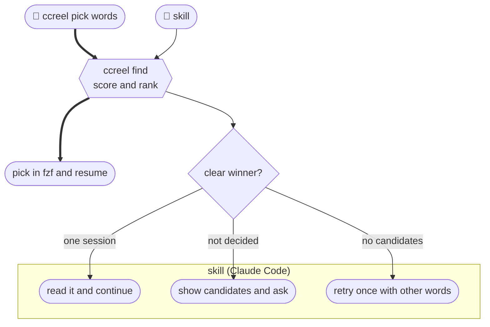
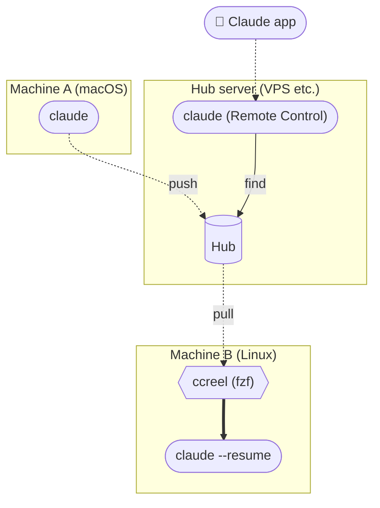

[🇯🇵 日本語](README.md) | [🇬🇧 English](README.en.md)

# ccreel

[](https://github.com/yktsnet/ccreel/actions/workflows/ci.yml)

A CLI for people who use Claude Code on more than one machine. It gathers session history into a hub, a store reachable over ssh, so you can find and resume any session from any machine.
The same search serves two cases: you browsing with fzf to find and resume a session quickly, and Claude Code pulling up the right conversation when you ask it to.
On a single machine, it still works as a list you can narrow with `@repo` and `#issue`, and Claude Code can read your history through it.


## Why

### You search: every machine's and every repo's conversations in one list

Type `ccreel` and fzf lists sessions from every machine and every config dir, newest first.
Narrow by repo with `@app`, by issue number with `#417`, or to the last 24 hours with `*0`. Conversations held in a worktree are grouped under the original repo, and the issue number comes from the branch or worktree name.
Enter moves to the directory where the conversation started and resumes it. Select several with Tab, and the second one onward opens in new tmux windows.

### Claude Code searches: the right conversation, or candidates, in one call

When you ask Claude Code to find "that thing we discussed before", it tends to call a list and a full-text search in turn, read deeply into the first hit, and miss the session that continued it.
With the bundled skill installed, Claude Code only needs a single `ccreel find` call.

```
> Let's continue #417

⏺ ccreel find 417 --json
  → decided: true  1c0e662e  @app #417「Lock invoices after month close」  issue #417 · body:417×6
⏺ ccreel outline 1c0e662e --json → ccreel show 1c0e662e --last 3 --json
  (reads the last 3 turns and picks up from there)
```

The CLI ranks the candidates and decides from the score gap whether one session is a clear winner, so Claude Code does not have to judge that each time. When there is no clear winner, it shows the candidates and asks before reading. `ccreel pick <words>`, which you type yourself, uses the same ranking. The scoring and the decision rule are in [docs/search.md](docs/search.md) (Japanese).



### Across machines: any hub with ssh and rsync will do

A conversation started on macOS does not show up in `claude --resume` on a Linux machine.
With ccreel, each machine pushes to the hub every minute and pulls when you open `ccreel`. A run with nothing changed finishes without connecting to the hub, so calling it every minute costs nothing.
The hub needs no ccreel installed; a VPS, a Raspberry Pi, or a local directory all work.
Put the hub on a small always-on Linux server, and the same server becomes your entry point from a phone. Run Claude Code there with Remote Control, and the Claude app on your phone can search and read conversations from every machine.



Syncing `projects/` as is does not make a session the same on machines whose home paths differ, because project names and `"cwd"` contain the home path.
On the ccreel hub, the home prefix in project names and in `"cwd"` is replaced with `~`. Whether sent from `/Users/alice` on macOS or `/home/alice` on Linux, the same session becomes the same bytes, and the pulling machine maps it back to its own home.

How it works is in [docs/sync.md](docs/sync.md) (Japanese).

## Quick Start

Each machine needs `claude`, `fzf`, `rg`, `rsync`, and `ssh` (installing with Nix brings them along). The hub only needs ssh key login plus `rsync`, `sh`, `find`, and `stat`.

```sh
nix profile install github:yktsnet/ccreel
# or
go install github.com/yktsnet/ccreel/cmd/ccreel@latest    # Go 1.24 or later
```

To use it from Claude Code, install the bundled skill (with Nix, it is at `share/ccreel/skills/ccreel`).

```sh
cp -r skills/ccreel ~/.claude/skills/
```

On a single machine, just type `ccreel`.

To connect several machines, set the hub on each and call push every minute.

```sh
export CCREEL_HUB=<hub-host>:ccreel-hub     # an ssh destination; a local directory also works
ccreel push                                 # the first run sends all local history
```

```cron
* * * * * CCREEL_HUB=<hub-host>:ccreel-hub ccreel push
```

Add one small Linux server, and it can serve as both the hub and the entry point from your phone. Install ccreel and the skill there too, give it the local directory as the hub, and call only push every minute.
The server does not pull. Instead, read-only commands such as `find`, `search`, and `show` read the hub directly ([docs/sync.md](docs/sync.md), Japanese).

```sh
export CCREEL_HUB=$HOME/ccreel-hub          # the hub itself, so a local directory
claude --remote-control                     # connect from the Claude app on your phone
```

```cron
* * * * * CCREEL_HUB=$HOME/ccreel-hub ccreel push
```

## Usage

```sh
ccreel                          # pull, then open fzf (= ccreel pick)
ccreel pick month-close         # list only sessions matching the words, ranked like find
ccreel resume 1c0e662e          # look up by ID prefix and resume

ccreel find 417 @app --json     # ranked candidates and whether one was decided
ccreel list --since 1d --json   # work from the last 24 hours
ccreel outline 1c0e662e --json  # table of contents, one line per turn
ccreel show 1c0e662e --last 3 --json
ccreel search "month-close" --json
```

fzf keys, JSON fields, environment variables, and flags are in [docs/usage.md](docs/usage.md) (Japanese).

Other tools can work with sessions by reading `list --json` and `show --json`. For example, [codeview](https://github.com/yktsnet/codeview#extensions) ships an example extension that turns the session list and each session into pages on the same site as your code and issues.

## Design Decisions

- **Sync sessions per file with rsync `--update`**: a jsonl is append-only and written by only one machine, so keeping the newer one never conflicts
- **The hub only stores; listing, search, and resume run on the local copy**: search is fast, works offline, and Claude Code never reaches the hub however often it calls
- **push compares against a local mirror and connects to the hub only when something changed**: an unchanged run finishes in milliseconds, so it can run every minute

Options, deciding factors, revisit criteria, and the reasons behind the tech choices are in [docs/design-decisions.md](docs/design-decisions.md) (Japanese).

## Scope

Used on macOS and Linux (including WSL), with two machines and two config dirs. The Linux server holding the hub doubles as the entry point from a phone.

- If two machines write the same session at once, the hub keeps the newer one
- Only the last 30 days are pulled locally; older sessions live only on the hub
- Sessions only on the hub can be read on the server that holds it, but not resumed
- Attachments (subagent transcripts, offloaded tool output) are not carried
- No MCP server, index DB, or LLM-generated titles

Behavior backed by tests is listed in [docs/guarantees.md](docs/guarantees.md) (Japanese). Anything not listed there may change without notice.

## License

[MIT](LICENSE)
