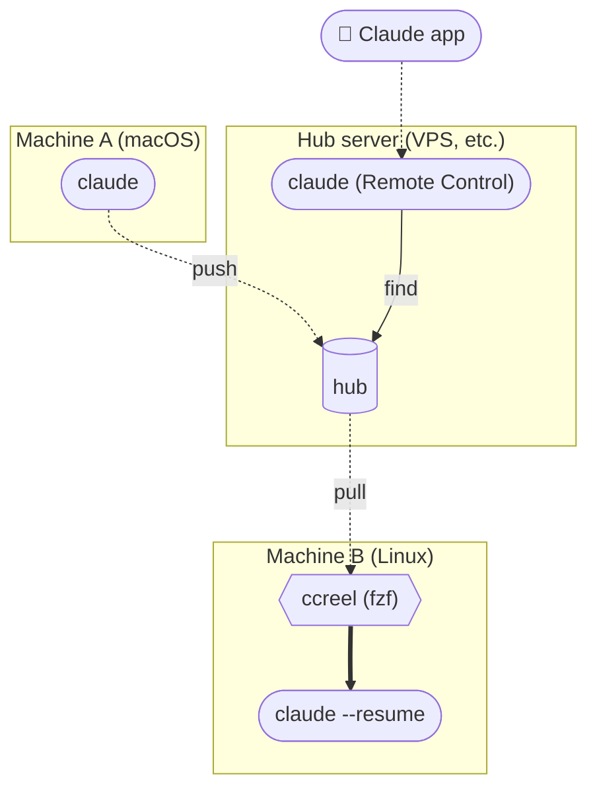

[🇯🇵 日本語](README.md) | [🇬🇧 English](README.en.md)

# ccreel

[](https://github.com/yktsnet/ccreel/actions/workflows/ci.yml)

A CLI that lists your past Claude Code conversations from every repo in one place and resumes the one you pick with Enter.
Claude Code itself can get the right conversation in a single call.
Add a hub, a store reachable over ssh, and conversations from your other machines join the same list.


## Why

In the Claude Code CLI, finding a past conversation and resuming it is hard. By default `/resume` shows only conversations from the current directory, gives each one two lines, and shows content only after you switch to the preview.
A conversation you no longer remember the repo of means moving from directory to directory to find it.

You look for past conversations in two situations, about equally often: searching from the shell yourself to resume where you left off, and asking Claude Code mid-conversation to find "that thing we talked about".
Using the same tool for both means the same words bring the same conversation to the top. When you check the conversation Claude Code chose, the same words list the same candidates.

Existing history tools did not cover both in one. Tools for reading conversations (such as [claude-history](https://github.com/raine/claude-history)) open a viewer when you pick a session, and resuming is a separate action.
Skills and MCP servers for Claude Code return a scored ranking and leave the choice of what to read to it, so Claude Code can read deep into the first hit and miss the session that continued it.

## Pick from the list and resume

Type `ccreel` and sessions from every repo and every config dir are listed one per line, newest first. fzf opens full screen, and the right pane shows the conversation under the cursor.
What you type narrows the list as you go. Narrow by repo with `@app`, by issue number with `#417`, or to the last 24 hours with `*0`, and combine them freely. Conversations held in a worktree are grouped under the original repo.
Enter moves to the directory the conversation was last working in and resumes it. Select several with Tab, and the second one onward opens in new tmux windows.

## Let Claude Code find it

With the bundled skill, Claude Code calls `ccreel find` once. ccreel scores the candidates, and when the top one is far enough ahead of the second, it returns `decided: true`, meaning that one is the answer.
Claude Code reads that one; when nothing is decided, it shows the candidates and asks before reading.

```
> I want to continue #417

⏺ ccreel find 417 --json
  → decided: true  1c0e662e  @app #417 "Lock invoices after month close"  issue #417 · body:417×6
⏺ ccreel outline 1c0e662e --json → ccreel show 1c0e662e --last 3 --json
  (reads the last three turns and picks up from there)
```

`ccreel pick <words>`, which you type yourself, uses the same ranking as `find`. How scores are given and when a result counts as decided is in [docs/search.md](docs/search.md) (Japanese).

## On several machines

A conversation started on macOS does not show up in `claude --resume` on a Linux machine.
With ccreel, each machine pushes to the hub and pulls when you open `ccreel`. Conversations carried over join the same list and search as local ones. Any hub reachable with ssh and rsync will do, and it needs no ccreel.
Put the hub on an always-on Linux server and run Claude Code there with Remote Control, and the Claude app on your phone can search conversations from every machine, even when the machine that wrote them is off.



How a session stays the same session across machines with different home paths is in [docs/sync.md](docs/sync.md) (Japanese).

## Quick Start

### On one machine

You need `claude`, `fzf`, and `rg` (installing with Nix brings them along).

```sh
nix profile install github:yktsnet/ccreel
# or
go install github.com/yktsnet/ccreel/cmd/ccreel@latest    # Go 1.24 or later
```

To use it from Claude Code, install the bundled skill (with Nix, it is at `share/ccreel/skills/ccreel`).

```sh
cp -r skills/ccreel ~/.claude/skills/
```

Then type `ccreel`.

### On several machines

Each machine also needs `rsync` and `ssh`. The hub needs only ssh key login and `rsync`, `sh`, `find`, and `stat`.
On each machine, set the hub and call push every minute. A run with nothing changed finishes without connecting to the hub.

```sh
export CCREEL_HUB=<hub-host>:ccreel-hub     # an ssh destination; a local directory also works
ccreel push                                 # the first run sends all local history
```

```cron
* * * * * CCREEL_HUB=<hub-host>:ccreel-hub ccreel push
```

To reach the hub server from your phone, install ccreel and the skill there too, give it the local directory as the hub, and call only push every minute.
The server does not pull. Instead, read-only commands such as `find`, `search`, and `show` read the hub directly ([docs/sync.md](docs/sync.md), Japanese).

```sh
export CCREEL_HUB=$HOME/ccreel-hub          # the hub itself, so a local directory
claude --remote-control                     # connect from the Claude app on your phone
```

```cron
* * * * * CCREEL_HUB=$HOME/ccreel-hub ccreel push
```

## Usage

```sh
ccreel                          # pull, then open fzf (= ccreel pick)
ccreel pick month-close         # list only sessions matching the words, ranked like find
ccreel resume 1c0e662e          # look up by ID prefix and resume

ccreel find 417 @app --json     # ranked candidates and whether one was decided
ccreel list --since 1d --json   # work from the last 24 hours
ccreel outline 1c0e662e --json  # table of contents, one line per turn
ccreel show 1c0e662e --last 3 --json
ccreel search "month-close" --json
```

fzf keys, JSON fields, environment variables, and flags are in [docs/usage.md](docs/usage.md) (Japanese).

Other tools can work with sessions by reading `list --json` and `show --json`. For example, [codeview](https://github.com/yktsnet/codeview#extensions) ships an example extension that turns the session list and each session into pages on the same site as your code and issues.

## Design Decisions

- **The CLI decides by score margin whether one conversation is decided**: Claude Code does not make that call, and the same request on the same history returns the same candidates and the same decision
- **No index DB; rg narrows candidates before reading**: `find` takes under a second on about 1.4 GB of local history
- **The hub only stores; listing, search, and resume run on the local copy**: search is fast, works offline, and Claude Code never reaches the hub however often it calls

Scoring is in [docs/search.md](docs/search.md); other decisions and the reasons behind the tech choices are in [docs/design-decisions.md](docs/design-decisions.md) (both Japanese).

## Scope

Used on macOS and Linux (including WSL), with two machines and two config dirs. The Linux server holding the hub doubles as the entry point from a phone.

On one machine:

- The list leaves out sessions run with `claude -p` and sessions with a single prompt (`--all` shows the single-prompt ones)
- The `#number` in the list comes from a number you put in the branch or worktree name
- No MCP server, no index DB, and no LLM-generated titles

On several machines:

- If two machines write the same session at once, the hub keeps the newer one
- Only the last 30 days are pulled locally; older sessions live only on the hub
- Sessions only on the hub can be read on the server holding the hub, but not resumed
- Attachments (subagent transcripts, offloaded tool output) are not carried

Behavior backed by tests is in [docs/guarantees.md](docs/guarantees.md). Behavior not listed there may change without notice.

## License

[MIT](LICENSE)
