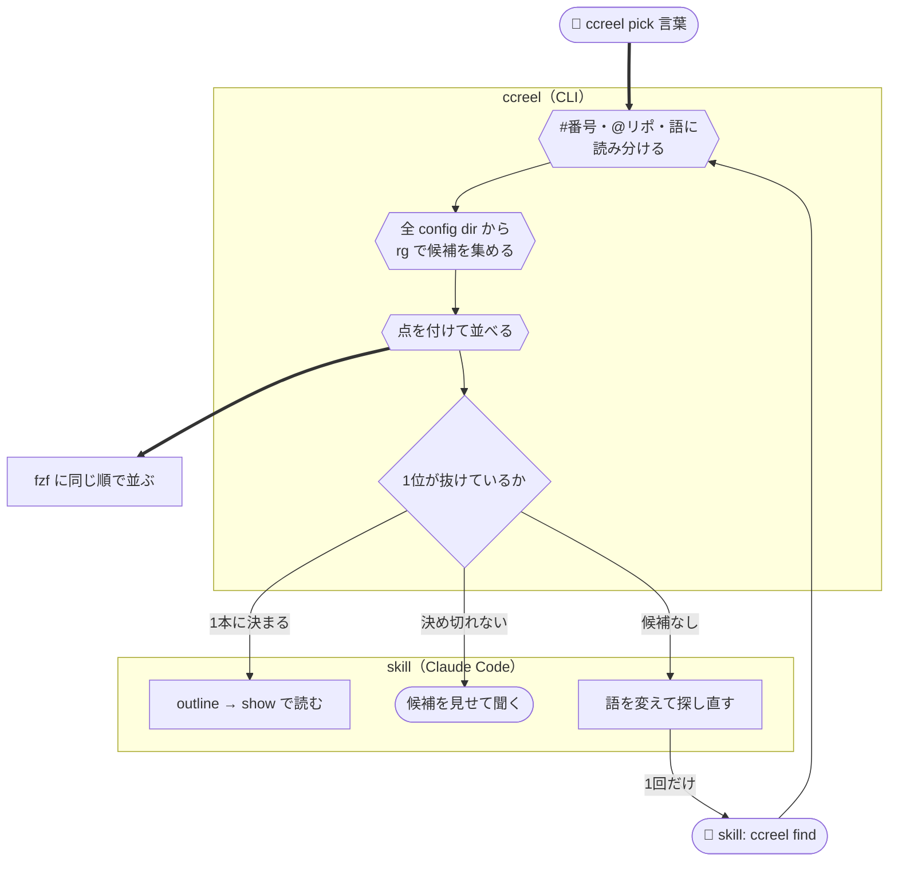

# ccreel

[](https://github.com/yktsnet/ccreel/actions/workflows/ci.yml)

Claude Code のセッション履歴を複数の端末からハブに集める CLI。
人が fzf で手早く探して resume する場面と、Claude Code に頼んで正しい会話をすぐ引かせる場面の両方に、同じ検索を使う。
端末が1台でも、`@リポ`・`#Issue番号` で絞れる一覧として使え、Claude Code からも履歴を読める。


## Why

### 人が探す: 全部の端末とリポの会話を、1つの一覧から

`ccreel` を打つと、全部の端末・全部の config dir のセッションが新しい順に fzf に並ぶ。
`@app` でリポ、`#417` で Issue 番号、`*0` で今日の分に絞れる。worktree で作業した会話も元のリポにまとまり、Issue 番号はブランチ名か worktree の名前から取る。
Enter で、その会話を始めたディレクトリへ移って resume する。Tab で複数を選ぶと、2本目からは tmux の新しいウィンドウで開く。

### Claude Code が探す: 1回の呼び出しで、正しい会話か候補か

Claude Code に「前に話したあの件」を探させると、一覧と全文検索を順に呼んで最初に当たった1本を深く読み、続きのセッションを見落とすことがある。
同梱の skill を入れると、Claude Code は `ccreel find` を1回呼ぶだけで済む。

```
> #417 の続きをやりたい

⏺ ccreel find 417 --json
  → decided: true  1c0e662e  @app #417「月次の締め処理」  issue #417・title:締め
⏺ ccreel outline 1c0e662e --json → ccreel show 1c0e662e --last 3 --json
  （直前の3ターンを読んで、続きから答える）
```

どの候補が上か、1本に決め切れるかは CLI が点差で決め、Claude Code には毎回判断させない。決め切れなければ、読み込む前に候補を見せて聞く。人の `ccreel pick <言葉>` も同じ順位で並ぶ。



点の付け方と判定の条件は [docs/search.md](docs/search.md) にある。

### 端末をまたぐ: ハブは ssh と rsync があれば何でもよい

macOS で始めた会話は、そのままでは Linux の端末の `claude --resume` に出てこない。
ccreel では各端末が毎分ハブへ push し、`ccreel` を開くときに pull する。変わったものが無い回はハブにつながずに終わるので、毎分呼んでも負荷はかからない。
ハブには ccreel を入れる必要がなく、VPS・Raspberry Pi・手元のディレクトリのどれでも置ける。仕組みは [docs/sync.md](docs/sync.md) にある。

## Quick Start

手元の端末に `claude`・`fzf`・`rg`・`rsync`・`ssh` が要る（Nix で入れれば一緒に入る）。ハブには、ssh の鍵認証でログインでき、`rsync`・`sh`・`find`・`stat` があれば足りる。

```sh
nix profile install github:yktsnet/ccreel
# または
go install github.com/yktsnet/ccreel/cmd/ccreel@latest    # Go 1.24 以上
```

1台で使うなら、`ccreel` と打つだけである。

複数の端末をつなぐときは、各端末でハブの宛先を決め、push を毎分呼ぶ。

```sh
export CCREEL_HUB=<hub-host>:ccreel-hub     # ssh の先。手元のディレクトリも指定できる
ccreel push                                 # 初回は手元の履歴を全部送る
```

```cron
* * * * * CCREEL_HUB=<hub-host>:ccreel-hub ccreel push
```

Claude Code から使うには、同梱の skill を入れる（Nix で入れた場合は `share/ccreel/skills/ccreel` にある）。

```sh
cp -r skills/ccreel ~/.claude/skills/
```

## Usage

```sh
ccreel                          # pull してから fzf を開く（= ccreel pick）
ccreel pick 締め処理            # 言葉に当たったセッションだけを、find と同じ順位で並べる
ccreel resume 1c0e662e          # ID の先頭で引いて resume する

ccreel find 417 @app --json     # 順位付きの候補と、決め切れたかどうか
ccreel list --since 1d --json   # 直近24時間の作業の一覧
ccreel outline 1c0e662e --json  # 1ターン1行の目次
ccreel show 1c0e662e --last 3 --json
ccreel search "締め処理" --json
```

fzf の操作・JSON の項目・環境変数・フラグは [docs/usage.md](docs/usage.md) にある。

## Design Decisions

- **セッションをファイル単位の rsync `--update` で合わせる**: jsonl は追記しかされず、1本は1台の端末でしか書かれないので、新しい方を残すだけで衝突しない
- **ハブは置き場だけにし、一覧・検索・resume は手元の写しで行う**: 検索が速く、オフラインでも動き、Claude Code が何度呼んでもハブまで行かない
- **運ぶのはセッション本体の jsonl だけにする**: resume に要るのは本体だけで、付属物は本体と同じくらいの容量を占める
- **push は手元の mirror と比べ、変わったものがあるときだけハブにつなぐ**: 変わったものが無い回は数ミリ秒で終わるので、毎分呼べる
- **config dir を分けずに1つの一覧に出す**: どの config dir で開いても会話の続きになり、リポの見分けは `@リポ` で足りる

選択肢・決め手・再検討の境界と、技術の選定理由は [docs/design-decisions.md](docs/design-decisions.md) にある。

## Scope

macOS と Linux（WSL を含む）で、2台の端末と2つの config dir で使っている。

- 同じセッションを2台で同時に書くと、ハブでは更新の新しい方が残る
- 手元へ pull するのは直近30日まで。それより古いセッションはハブにだけある
- 付属物（サブエージェントの記録・退避したツール出力）は運ばない
- MCP サーバ・索引 DB・LLM による題の生成は持たない

テストで裏付けた振る舞いは [docs/guarantees.md](docs/guarantees.md) にある。そこに載っていない振る舞いは、予告なく変わることがある。

## License

[MIT](LICENSE)
