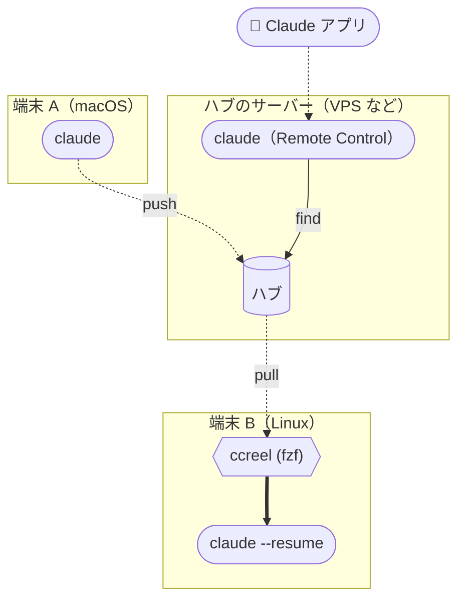

[🇯🇵 日本語](README.md) | [🇬🇧 English](README.en.md)

# ccreel

[](https://github.com/yktsnet/ccreel/actions/workflows/ci.yml)

Claude Code の過去の会話を、全部のリポから1つの一覧で探し、Enter ですぐ resume する CLI。
Claude Code 自身も同じ検索を1回呼ぶだけで正しい会話を引ける。
ssh でつながる置き場（ハブ）を足せば、ほかの端末の会話も同じ一覧に並ぶ。


## Why

### 人が探す: 選んですぐ resume する

`ccreel` と打つと、全部のリポ・全部の config dir のセッションが1行に1本ずつ新しい順に並ぶ。fzf は全画面で開き、右のペインには選んでいる会話の中身を出す。
打った文字がそのまま絞り込みになる。`@app` でリポ、`#417` で Issue 番号、`*0` で直近24時間のものに絞れ、組み合わせてもよい。
worktree で作業した会話も元のリポにまとまる。Issue 番号はブランチ名か worktree の名前から取るので、番号を名前に入れて作業していれば `#417` で引ける。
Enter で、その会話で最後に作業していたディレクトリへ移って resume する。Tab で複数を選ぶと、2本目からは tmux の新しいウィンドウで開く。

### Claude Code が探す: 1回の呼び出しで、正しい会話か候補か

Claude Code に「前に話したあの件」を探させると、一覧と全文検索を順に呼んで最初に当たった1本を深く読み、続きのセッションを見落とすことがある。
同梱の skill を入れると、Claude Code は `ccreel find` を1回呼ぶだけで済む。

```
> #417 の続きをやりたい

⏺ ccreel find 417 --json
  → decided: true  1c0e662e  @app #417「Lock invoices after month close」  issue #417 · body:417×6
⏺ ccreel outline 1c0e662e --json → ccreel show 1c0e662e --last 3 --json
  （直前の3ターンを読んで、続きから答える）
```

候補の順位と、1本に決め切れるかどうかは CLI が点差で判定し、Claude Code には毎回判断させない。決め切れなければ、読む前に候補を見せて聞く。人が打つ `ccreel pick <言葉>` も同じ順位で並ぶ。点の付け方と判定の条件は [docs/search.md](docs/search.md) にある。

```mermaid
flowchart TD
  human(["👤 ccreel pick 言葉"])
  claude(["🤖 skill"])
  find{{"ccreel find<br/>点を付けて並べる"}}
  human ==> find
  claude --> find
  find ==> resume(["fzf で選んで resume"])
  find --> dec{"決め切れたか"}
  subgraph S["skill（Claude Code）"]
    read(["読んで続きから答える"])
    ask(["候補を見せて聞く"])
    retry(["語を変えて1回探し直す"])
  end
  dec -->|"1本に決まる"| read
  dec -->|"決め切れない"| ask
  dec -->|"候補なし"| retry
```



### 端末をまたぐ: ハブは ssh と rsync があれば何でもよい

macOS で始めた会話は、そのままでは Linux の端末の `claude --resume` に出てこない。
ccreel では各端末が毎分ハブへ push し、`ccreel` を開くときに pull する。変わったものが無い回はハブにつながずに終わるので、毎分呼んでも負荷はかからない。
ハブには ccreel を入れる必要がなく、VPS・Raspberry Pi・手元のディレクトリのどれでも置ける。
ハブを常時動く小さな Linux サーバーに置けば、同じサーバーにスマホからもつなげる。サーバーで Claude Code を Remote Control で動かすと、スマホの Claude アプリから全部の端末の会話を探して読める。



`projects/` をそのまま同期するだけでは、ホームのパスが違う端末どうしで同じセッションとして扱えない。プロジェクト名と `"cwd"` にホームのパスが入っているためである。
ccreel のハブでは、プロジェクト名と `"cwd"` の先頭のホームを `~` に置き換えて持つ。macOS の `/Users/alice` と Linux の `/home/alice` のどちらから送っても同じセッションは同じバイト列になり、pull した端末では自分のホームへ戻す。

仕組みは [docs/sync.md](docs/sync.md) にある。

## 似た道具との違い

- **Claude Code の `/resume`**: 1本に2行を使い、会話の中身はプレビューに切り替えないと見えない。既定ではいまのディレクトリのセッションだけを出し、config dir と端末はまたがない
- **会話を読むための道具**（[claude-history](https://github.com/raine/claude-history) など）: 選ぶと会話を読む画面が開き、resume は別のキーで行う。Claude Code にも点数つきの順位を返すが、どれを読むかは Claude Code に委ねる
- **端末のあいだで同期する道具**: 会話を運んで標準の `/resume` に出す。探す機能は無い

ccreel は選んだらすぐ resume することと、Claude Code に1本へ決め切った結果を返すことに絞っている。会話の一部を細かく読んで引用する用途には、会話を読むための道具が向いている。

## Quick Start

手元の端末に `claude`・`fzf`・`rg`・`rsync`・`ssh` が要る（Nix で入れれば一緒に入る）。ハブには、ssh の鍵認証でログインでき、`rsync`・`sh`・`find`・`stat` があれば足りる。

```sh
nix profile install github:yktsnet/ccreel
# または
go install github.com/yktsnet/ccreel/cmd/ccreel@latest    # Go 1.24 以上
```

Claude Code から使うには、同梱の skill を入れる（Nix で入れた場合は `share/ccreel/skills/ccreel` にある）。

```sh
cp -r skills/ccreel ~/.claude/skills/
```

1台で使うなら、`ccreel` と打つだけである。

複数の端末をつなぐときは、各端末でハブの宛先を決め、push を毎分呼ぶ。

```sh
export CCREEL_HUB=<hub-host>:ccreel-hub     # ssh の先。手元のディレクトリも指定できる
ccreel push                                 # 初回は手元の履歴を全部送る
```

```cron
* * * * * CCREEL_HUB=<hub-host>:ccreel-hub ccreel push
```

小さな Linux サーバーを1台足すと、ハブと、スマホからつなぐ先を兼ねられる。サーバーにも ccreel と skill を入れ、宛先には手元のディレクトリを渡して push だけを毎分呼ぶ。
サーバーは pull しない。代わりに `find`・`search`・`show` などの読むだけのコマンドが、ハブを直に読む（[docs/sync.md](docs/sync.md#ハブを置いたサーバーで読む)）。

```sh
export CCREEL_HUB=$HOME/ccreel-hub          # ハブ自身なので手元のディレクトリを渡す
claude --remote-control                     # スマホの Claude アプリからつなぐ
```

```cron
* * * * * CCREEL_HUB=$HOME/ccreel-hub ccreel push
```

## Usage

```sh
ccreel                          # pull してから fzf を開く（= ccreel pick）
ccreel pick 締め処理            # 言葉に当たったセッションだけを、find と同じ順位で並べる
ccreel resume 1c0e662e          # ID の先頭で引いて resume する

ccreel find 417 @app --json     # 順位付きの候補と、決め切れたかどうか
ccreel list --since 1d --json   # 直近24時間の作業の一覧
ccreel outline 1c0e662e --json  # 1ターン1行の目次
ccreel show 1c0e662e --last 3 --json
ccreel search "締め処理" --json
```

fzf の操作・JSON の項目・環境変数・フラグは [docs/usage.md](docs/usage.md) にある。

`list --json` と `show --json` を読めば、ほかの道具からもセッションを扱える。たとえば [codeview](https://github.com/yktsnet/codeview#extensions) には、セッションの一覧と本文を、コードや Issue と同じサイトのページにする拡張の例がある。

## Design Decisions

- **セッションをファイル単位の rsync `--update` で合わせる**: jsonl は追記しかされず、1本は1台の端末でしか書かれないので、新しい方を残すだけで衝突しない
- **ハブは置き場だけにし、一覧・検索・resume は手元の写しで行う**: 検索が速く、オフラインでも動き、Claude Code が何度呼んでもハブまで行かない
- **push は手元の mirror と比べ、変わったものがあるときだけハブにつなぐ**: 変わったものが無い回は数ミリ秒で終わるので、毎分呼べる

選択肢・決め手・再検討の境界と、技術の選定理由は [docs/design-decisions.md](docs/design-decisions.md) にある。

## Scope

macOS と Linux（WSL を含む）で、2台の端末と2つの config dir で使っている。ハブを置いた Linux サーバーは、スマホからつなぐ先も兼ねている。

- 同じセッションを2台で同時に書くと、ハブでは更新の新しい方が残る
- 手元へ pull するのは直近30日まで。それより古いセッションはハブにだけある
- ハブにしか無いセッションは、ハブを置いたサーバーで読めるが、resume はできない
- 付属物（サブエージェントの記録・退避したツール出力）は運ばない
- MCP サーバ・索引 DB・LLM によるタイトルの生成は持たない

テストで裏付けた振る舞いは [docs/guarantees.md](docs/guarantees.md) にある。そこに載っていない振る舞いは、予告なく変わることがある。

## License

[MIT](LICENSE)
